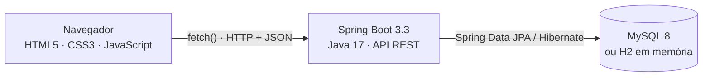

# SisAcad — Biblioteca e Achados e Perdidos (POC)

Sistema acadêmico com dois módulos:

- **Biblioteca** — cadastro, busca, edição e exclusão de livros; empréstimos, devoluções e histórico.
- **Achados e Perdidos** — registro de objetos encontrados com descrição livre, controle de status e devolução ao dono.

Stack: **Java 17 + Spring Boot 3.3 (Web, Data JPA, Validation) + Maven + MySQL**, frontend em **HTML, CSS e JavaScript puro** (Fetch API), servido pelo próprio Spring Boot. Detalhes em [Tecnologias utilizadas](#tecnologias-utilizadas).

Disciplina: Programação para Internet — 2º bimestre · Apresentação: 19/11

## Equipe

Trabalho desenvolvido pelos alunos:

- **Gustavo Rocha Santos**
- **Carlos Eduardo Gabriel Valeriano da Silva**
- **Matheus Henrique Geraldo Bento**

---

## Sobre o projeto

### Problema

Na instituição, o controle do acervo da biblioteca e dos objetos perdidos é feito em papel ou planilhas.
Com isso, não se sabe com rapidez se um livro está disponível, com quem ele está, desde quando,
nem se um objeto encontrado já foi devolvido ao dono. O SisAcad centraliza os dois controles em uma
aplicação web com banco de dados.

### Público-alvo

- **Quem usa o sistema:** funcionários da biblioteca e da secretaria (operadores), pela interface administrativa.
- **Quem é beneficiado:** alunos e servidores que pegam livros emprestados ou perderam objetos no campus.
  Eles são cadastrados como usuários, mas não acessam o sistema diretamente.

### Requisitos funcionais principais

| ID | Requisito |
|---|---|
| RF01 | Cadastrar, listar, pesquisar (título/autor), editar e excluir livros |
| RF02 | Registrar empréstimos e devoluções, mantendo o histórico e a disponibilidade dos livros |
| RF03 | Registrar objetos encontrados com descrição livre, atualizar o status e registrar a devolução ao dono |

A lista completa (16 requisitos funcionais, não funcionais e 12 regras de negócio) está em
[`docs/documentacao-tecnica.md`](docs/documentacao-tecnica.md).

### Escopo

**Dentro do escopo (entregue):** os dois módulos acima, painel com indicadores, API REST, banco MySQL/H2,
validações e tratamento de erros, testes automáticos.

**Fora do escopo (evoluções futuras):** login e perfis de acesso, multa por atraso, reserva de livros,
notificação por e-mail e fotos dos objetos. Essas exclusões mantêm o projeto viável para o prazo de 19/11.

---

## Tecnologias utilizadas

O SisAcad é uma aplicação web em camadas: o **frontend** (HTML, CSS e JavaScript) roda no navegador e
conversa por **API REST/JSON** com o **backend** (Java + Spring Boot), que grava os dados no **MySQL**.
Tudo roda em uma única aplicação, iniciada com um comando, em `http://localhost:8080`.



### Backend

| Tecnologia | Versão | Para que é usada no projeto |
|---|---|---|
| **Java** | 17 (LTS) | Linguagem orientada a objetos de todo o backend: entidades, regras de negócio e API |
| **Spring Boot** | 3.3.5 | Framework base: sobe o servidor web embutido (Tomcat), configura tudo automaticamente e serve o frontend |
| **Spring Web** | (Spring Boot) | Cria a API REST com `@RestController`, `@GetMapping`, `@PostMapping` etc. e converte objetos Java em JSON (Jackson) |
| **Spring Data JPA** | (Spring Boot) | Acesso ao banco pelos repositories; gera o SQL a partir do nome do método (ex.: `findByTituloContainingIgnoreCase`) |
| **Hibernate** | (Spring Boot) | Implementação do JPA: transforma as classes `@Entity` em tabelas e cria/atualiza o banco automaticamente |
| **Bean Validation** | (Spring Boot) | Valida os dados recebidos com anotações como `@NotBlank`, `@NotNull` e `@PastOrPresent` |
| **Maven** | 3.8+ | Gerencia as dependências declaradas no `pom.xml`, compila, roda os testes e gera o `.jar` |

### Banco de dados

| Tecnologia | Versão | Para que é usada no projeto |
|---|---|---|
| **MySQL** | 8.x | Banco relacional definitivo, com chaves primárias, estrangeiras, `UNIQUE` e `CHECK` |
| **MySQL Connector/J** | (Spring Boot) | Driver JDBC que conecta o Java ao MySQL |
| **H2 Database** | (Spring Boot) | Banco em memória usado no perfil `h2` e nos testes: permite rodar e apresentar sem instalar MySQL |

### Frontend

| Tecnologia | Para que é usada no projeto |
|---|---|
| **HTML5** | Estrutura das quatro telas (Painel, Biblioteca, Empréstimos, Achados e Perdidos) em uma única página, com formulários e tabelas |
| **CSS3** | Visual da interface: variáveis de cor, Grid e Flexbox para o layout, badges coloridos de status e *media queries* para o celular |
| **JavaScript (ES6+)** | Lógica das telas sem frameworks: navegação, validação dos campos, montagem das listas e avisos |
| **Fetch API** | Faz as requisições HTTP (GET, POST, PUT, PATCH, DELETE) para a API e recebe JSON, sem recarregar a página (`async/await`) |

O frontend fica em `src/main/resources/static/` e é entregue pelo próprio Spring Boot, por isso não precisa de
Node.js, npm nem servidor separado.

### Testes

| Tecnologia | Para que é usada no projeto |
|---|---|
| **JUnit 5** | Escrita e execução dos 13 testes automáticos |
| **Mockito** | Simula os repositories para testar as regras de negócio dos services sem banco de dados |
| **Spring Boot Test + MockMvc** | Teste de integração: sobe a aplicação com H2 e chama a API de verdade |
| **Postman** | Testes manuais da API com a coleção pronta em `postman/` |

### Ferramentas de desenvolvimento

| Ferramenta | Uso |
|---|---|
| **VS Code** + Extension Pack for Java | Edição, execução (F5) e depuração; configurações prontas em `.vscode/` |
| **IntelliJ IDEA** | Alternativa ao VS Code (opcional) |
| **MySQL Workbench** | Visualizar o banco e executar `database/script.sql` |
| **Git e GitHub** | Versionamento e entrega do código |

### Por que essas escolhas

- **Spring Boot** elimina configuração manual: um único comando sobe servidor, API, banco e telas.
- **Arquitetura em camadas** (Controller → Service → Repository → Model) deixa cada responsabilidade em um lugar e facilita testar as regras.
- **JavaScript puro com `fetch()`** atende ao pedido da disciplina e deixa cada linha da interface fácil de explicar.
- **Perfil H2** garante que o sistema rode em qualquer computador na apresentação, mesmo sem MySQL instalado.

---

## 1. Pré-requisitos

| Ferramenta | Versão | Observação |
|---|---|---|
| JDK | 17 ou superior | `java -version` |
| Maven | 3.8+ | Já vem embutido no IntelliJ IDEA |
| MySQL | 8.x | Opcional: dá para rodar sem MySQL (ver 2.1) |

## 2. Como executar

### 2.1 Modo rápido — sem instalar MySQL (banco em memória H2)

Ideal para testar ou apresentar em qualquer computador:

```bash
mvn spring-boot:run -Dspring-boot.run.profiles=h2
```

> No **PowerShell** coloque o parâmetro entre aspas:
> `mvn spring-boot:run "-Dspring-boot.run.profiles=h2"`

Abra **http://localhost:8080**. Os dados de exemplo são criados automaticamente
(e apagados quando a aplicação para).

### 2.2 Modo oficial — com MySQL

1. Garanta que o MySQL está rodando em `localhost:3306`.
2. Usuário/senha padrão configurados: `root` / `root`. Se forem outros, edite
   `src/main/resources/application.properties` **ou** defina variáveis de ambiente:
   ```bash
   # Linux/Mac
   export DB_USER=root
   export DB_PASSWORD=suasenha
   # Windows (PowerShell)
   $env:DB_USER="root"; $env:DB_PASSWORD="suasenha"
   ```
3. Rode:
   ```bash
   mvn spring-boot:run
   ```
4. Abra **http://localhost:8080**.

O banco `sistema_academico` e as tabelas são criados automaticamente na primeira execução.
Se preferir criar pelo MySQL Workbench, execute `database/script.sql` antes.

### 2.3 Pelo VS Code

1. Instale a extensão **Extension Pack for Java** (o VS Code sugere ao abrir a pasta).
2. `Arquivo > Abrir Pasta` → selecione a pasta `sistema-academico` (a que contém o `pom.xml`).
3. Aguarde a barra inferior mostrar **Java: Ready** (na primeira vez baixa as dependências).
4. `Ctrl+Shift+D` → escolha **SisAcad (H2 - sem MySQL)** ou **SisAcad (MySQL)** → `F5`.
5. Quando aparecer `Started SistemaAcademicoApplication`, abra http://localhost:8080.

As duas opções já estão configuradas em `.vscode/launch.json` (a senha do MySQL fica lá).
Não é preciso instalar o Maven: a extensão Java resolve as dependências sozinha.

### 2.4 Pelo IntelliJ IDEA

`File > Open` → selecione a pasta do projeto (o IntelliJ reconhece o `pom.xml`) →
abra `SistemaAcademicoApplication.java` → clique em ▶ **Run**.
Para usar o H2 pela IDE: `Run > Edit Configurations > Active profiles: h2`.

### 2.5 Gerar o .jar (para levar a outro computador)

```bash
mvn clean package
java -jar target/sistema-academico-1.0.0.jar                       # MySQL
java -jar target/sistema-academico-1.0.0.jar --spring.profiles.active=h2   # H2
```

## 3. Estrutura do projeto

```
sistema-academico/
├── pom.xml                         # dependências Maven
├── .vscode/                        # configurações de execução do VS Code (H2 e MySQL)
├── database/script.sql             # modelo relacional + dados de exemplo
├── docs/
│   ├── documentacao-tecnica.md            # requisitos, UML, ER, API, casos de teste
│   ├── Documentacao-Tecnica-SisAcad.pdf   # mesma documentação em PDF, com diagramas
│   ├── Guia-Instalacao-SisAcad.pdf        # passo a passo de instalação e execução
│   └── evidencias/                        # prints de execução e testes
├── postman/sisacad.postman_collection.json
└── src/
    ├── main/
    │   ├── java/br/edu/sistemaacademico/
    │   │   ├── SistemaAcademicoApplication.java   # classe principal
    │   │   ├── controller/   # recebe requisições HTTP (REST)
    │   │   ├── service/      # regras de negócio
    │   │   ├── repository/   # acesso ao banco (Spring Data JPA)
    │   │   ├── model/        # entidades e enums de status
    │   │   ├── dto/          # objetos de entrada/saída da API
    │   │   ├── exception/    # erros de negócio + tratamento global
    │   │   └── config/       # CORS e dados iniciais
    │   └── resources/
    │       ├── application.properties       # MySQL
    │       ├── application-h2.properties    # perfil H2
    │       └── static/                      # frontend
    │           ├── index.html
    │           ├── css/style.css
    │           └── js/ (api, painel, livros, emprestimos, objetos, app)
    └── test/java/br/edu/sistemaacademico/   # 13 testes automáticos (JUnit 5 + Mockito)
```

## 4. Endpoints da API

Base: `http://localhost:8080/api`

| Método | Endpoint | Descrição |
|---|---|---|
| GET | `/dashboard` | Indicadores do painel |
| GET | `/livros?busca=&status=` | Lista livros (busca por título/autor, filtro por status) |
| GET | `/livros/{id}` | Detalha um livro |
| GET | `/livros/{id}/disponibilidade` | Consulta disponibilidade |
| POST | `/livros` | Cadastra livro (sempre entra DISPONIVEL) |
| PUT | `/livros/{id}` | Edita dados cadastrais |
| DELETE | `/livros/{id}` | Exclui (bloqueado se houver empréstimos) |
| GET | `/emprestimos?status=` | Histórico de empréstimos |
| POST | `/emprestimos` | Registra empréstimo `{livroId, usuarioId, dataEmprestimo}` |
| PUT | `/emprestimos/{id}/devolucao` | Registra devolução |
| GET | `/usuarios` | Lista usuários |
| POST | `/usuarios` | Cadastra usuário |
| GET | `/objetos?busca=&status=` | Lista objetos |
| GET | `/objetos/{id}` | Detalha objeto |
| POST | `/objetos` | Registra objeto (sempre entra ENCONTRADO) |
| PUT | `/objetos/{id}` | Edita dados do objeto |
| PATCH | `/objetos/{id}/status` | Alterna ENCONTRADO ↔ EM_ESTOQUE `{status}` |
| PUT | `/objetos/{id}/devolucao` | Devolve ao dono `{nomeProprietario}` |
| DELETE | `/objetos/{id}` | Exclui registro |

Códigos de resposta: `200` OK · `201` criado · `204` excluído · `400` dados inválidos ·
`404` não encontrado · `409` regra de negócio violada · `500` erro interno.
Erros sempre voltam como JSON: `{ "status": 409, "mensagem": "O livro ... já está emprestado." }`.

Importe `postman/sisacad.postman_collection.json` no Postman para testar todos os endpoints.

## 5. Regras de negócio implementadas

| Regra | Onde |
|---|---|
| Livro novo sempre DISPONÍVEL | `LivroService.criar` |
| ISBN não pode repetir | `LivroService.criar/atualizar` + UNIQUE no banco |
| Empréstimo muda livro para EMPRESTADO | `EmprestimoService.registrar` |
| Não empresta livro já emprestado | `EmprestimoService.registrar` |
| Devolução: empréstimo DEVOLVIDO + livro DISPONÍVEL | `EmprestimoService.registrarDevolucao` |
| Histórico preservado (empréstimo nunca é apagado) | modelo + `LivroService.excluir` |
| Livro com histórico não pode ser excluído | `LivroService.excluir` + FK RESTRICT |
| Objeto novo sempre ENCONTRADO | `ObjetoEncontradoService.registrar` |
| ENCONTRADO ↔ EM_ESTOQUE; DEVOLVIDO só pela devolução (com nome do dono) | `ObjetoEncontradoService` |
| Operações com mais de uma tabela são atômicas | `@Transactional` nos services |

## 6. Testes e evidências

### Testes automáticos (13 testes — JUnit 5 + Mockito)

| Classe de teste | O que verifica |
|---|---|
| `LivroServiceTest` (3) | Livro novo entra DISPONÍVEL · ISBN duplicado é recusado · livro com histórico não pode ser excluído |
| `EmprestimoServiceTest` (4) | Empréstimo muda livro para EMPRESTADO · livro emprestado não pode ser emprestado de novo · devolução libera o livro · não devolve duas vezes |
| `ObjetoEncontradoServiceTest` (3) | Objeto novo entra ENCONTRADO · DEVOLVIDO só pela devolução · devolução registra dono e data |
| `ApiIntegracaoTest` (3) | `GET /api/livros` responde 200 com JSON · emprestar o mesmo livro duas vezes responde 409 · livro inexistente responde 404 |

**Como rodar no VS Code:** ícone de frasco (**Testing**) na barra lateral → **Run All Tests**.
**Pelo terminal (com Maven):** `mvn test`.
Os testes usam o banco H2 em memória: não precisam de MySQL.

### Testes manuais e evidências

- 20 casos de teste manuais: `docs/documentacao-tecnica.md`, seção 8.
- Prints de execução (testes verdes, terminal, telas, JSON da API): pasta [`docs/evidencias/`](docs/evidencias/).

## 7. Problemas comuns

| Sintoma | Solução |
|---|---|
| `Access denied for user 'root'` | Ajuste usuário/senha (item 2.2) |
| `Communications link failure` | MySQL não está rodando — inicie o serviço ou use o perfil H2 |
| `Port 8080 already in use` | Feche a outra aplicação ou rode com `--server.port=8081` |
| Tela abre mas não carrega dados | O backend precisa estar rodando; abra pelo endereço http://localhost:8080 |

## 8. Documentação

| Documento | Conteúdo |
|---|---|
| [`docs/Documentacao-Tecnica-SisAcad.pdf`](docs/Documentacao-Tecnica-SisAcad.pdf) | Planejamento, requisitos, casos de uso, diagramas de classes, estados, ER e sequência, arquitetura, API, frontend, testes e glossário |
| [`docs/Guia-Instalacao-SisAcad.pdf`](docs/Guia-Instalacao-SisAcad.pdf) | Instalação do Java e das extensões do VS Code e passo a passo para rodar |
| [`docs/documentacao-tecnica.md`](docs/documentacao-tecnica.md) | Versão em texto da documentação técnica (diagramas em Mermaid) |
| [`database/script.sql`](database/script.sql) | Script de criação do banco com comentários |
