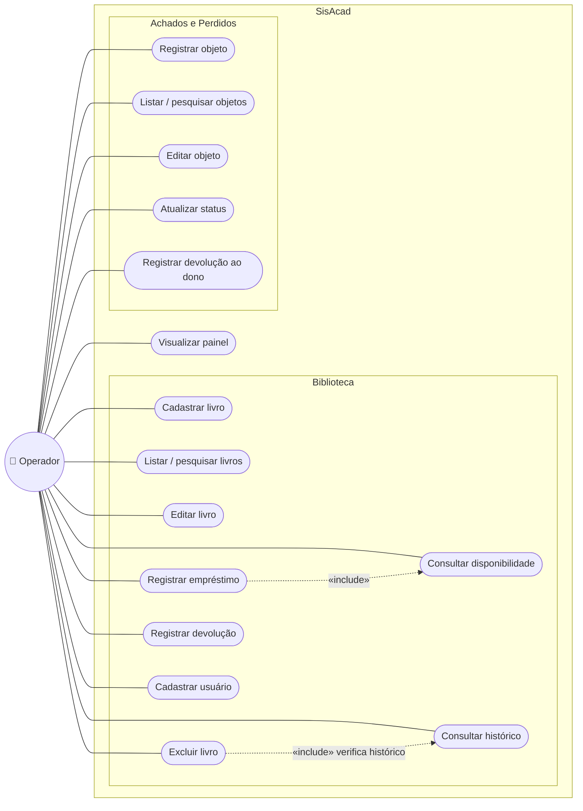
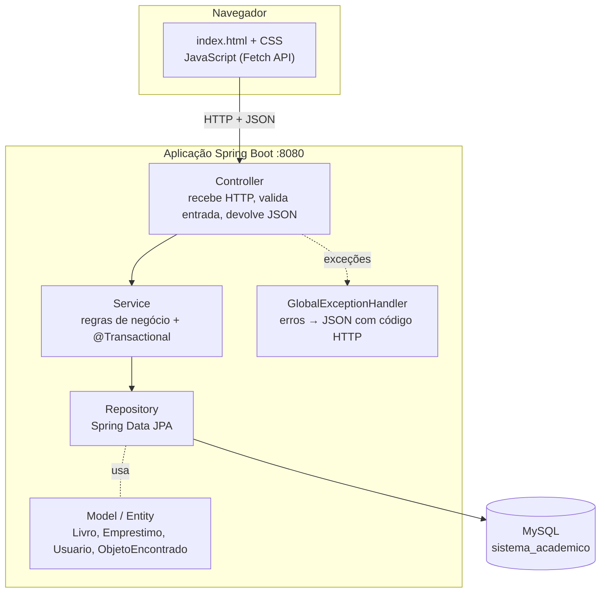
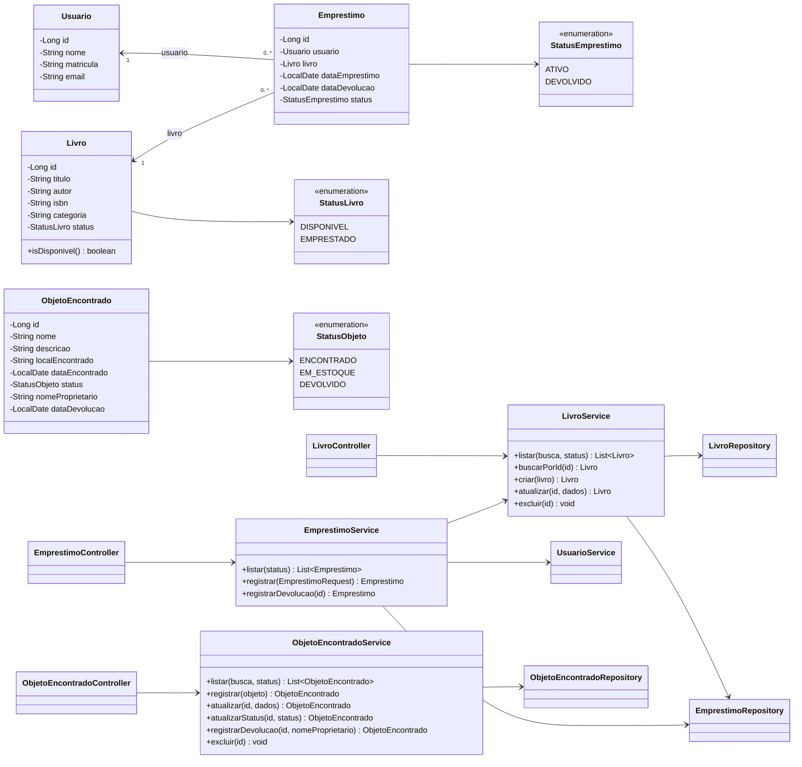
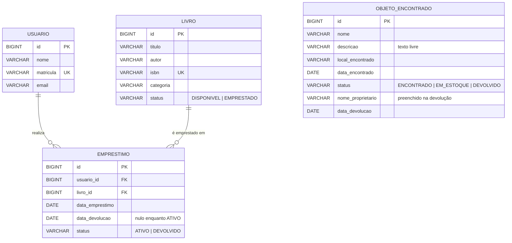

# Documentação Técnica — SisAcad

Sistema Acadêmico de Gerenciamento de Biblioteca e Achados e Perdidos.

> Os diagramas abaixo estão em **Mermaid**: aparecem desenhados no GitHub, no VS Code
> (extensão *Markdown Preview Mermaid Support*) e em https://mermaid.live (cole o código para exportar PNG).

---

## 1. Visão geral

A instituição precisa controlar (a) o acervo e os empréstimos da biblioteca e (b) os objetos
perdidos encontrados no campus. Hoje esses controles costumam ser feitos em papel ou planilhas,
o que dificulta saber se um livro está disponível, quem está com ele e se um objeto já foi devolvido.

O SisAcad centraliza os dois controles em uma aplicação web única, com banco de dados relacional.

**Público-alvo**

- **Operador (ator do sistema):** funcionário da biblioteca ou da secretaria — usa a interface administrativa.
- **Beneficiados:** alunos e servidores que pegam livros emprestados ou perderam objetos (cadastrados como usuários, não acessam o sistema).

**Escopo:** módulos de Biblioteca e Achados e Perdidos, painel, API REST e banco de dados.
**Fora do escopo:** login, multas por atraso, reservas, e-mail e fotos de objetos.

## 2. Requisitos

### 2.1 Requisitos funcionais

| ID | Requisito | Módulo |
|---|---|---|
| RF01 | Cadastrar livros (título, autor, ISBN, categoria) | Biblioteca |
| RF02 | Listar livros cadastrados | Biblioteca |
| RF03 | Consultar livros por título ou autor | Biblioteca |
| RF04 | Editar informações dos livros | Biblioteca |
| RF05 | Excluir livros sem empréstimos registrados | Biblioteca |
| RF06 | Registrar empréstimos (livro, usuário, data) | Biblioteca |
| RF07 | Registrar devoluções | Biblioteca |
| RF08 | Consultar a disponibilidade dos livros | Biblioteca |
| RF09 | Manter e exibir o histórico de empréstimos | Biblioteca |
| RF10 | Cadastrar usuários (nome, matrícula, e-mail) | Biblioteca |
| RF11 | Registrar objetos encontrados com descrição livre | Achados |
| RF12 | Listar e pesquisar objetos | Achados |
| RF13 | Editar informações dos objetos | Achados |
| RF14 | Atualizar status (ENCONTRADO ↔ EM_ESTOQUE) | Achados |
| RF15 | Registrar devolução ao proprietário | Achados |
| RF16 | Exibir painel com indicadores dos dois módulos | Geral |

### 2.2 Requisitos não funcionais

| ID | Requisito |
|---|---|
| RNF01 | Backend em Java 17 + Spring Boot 3, build com Maven |
| RNF02 | Persistência em MySQL via Spring Data JPA (H2 opcional para demonstração) |
| RNF03 | Comunicação frontend/backend por API REST com JSON (Fetch API) |
| RNF04 | Interface web responsiva (desktop e celular), sem frameworks de frontend |
| RNF05 | Arquitetura em camadas (Controller, Service, Repository, Model) |
| RNF06 | Validação de dados no frontend e no backend; mensagens de erro claras |
| RNF07 | Integridade referencial no banco (PK, FK, UNIQUE, CHECK) |
| RNF08 | Instalação simples: um comando (`mvn spring-boot:run`) sobe tudo |

### 2.3 Regras de negócio

| ID | Regra |
|---|---|
| RN01 | Todo livro novo inicia como DISPONÍVEL |
| RN02 | O ISBN é único |
| RN03 | Ao registrar empréstimo, o livro passa para EMPRESTADO |
| RN04 | Não é permitido emprestar livro já EMPRESTADO |
| RN05 | Na devolução, o empréstimo vira DEVOLVIDO e o livro volta a DISPONÍVEL |
| RN06 | Empréstimos nunca são apagados (histórico) |
| RN07 | Livro com empréstimos registrados não pode ser excluído |
| RN08 | A data do empréstimo não pode ser futura |
| RN09 | Todo objeto novo inicia como ENCONTRADO |
| RN10 | Objeto pode ir para EM_ESTOQUE quando guardado |
| RN11 | Objeto vira DEVOLVIDO somente pela operação de devolução, informando quem retirou |
| RN12 | Objeto DEVOLVIDO não muda mais de status |

## 3. Diagrama de casos de uso



### Descrição resumida — UC6 Registrar empréstimo

| Item | Descrição |
|---|---|
| Ator | Operador |
| Pré-condição | Livro e usuário cadastrados |
| Fluxo principal | 1. Operador abre Empréstimos. 2. Seleciona livro (lista só os disponíveis) e usuário. 3. Informa a data. 4. Confirma. 5. Sistema grava o empréstimo como ATIVO e muda o livro para EMPRESTADO. |
| Fluxo alternativo | 5a. Livro já emprestado → sistema exibe "O livro ... já está emprestado." e nada é gravado. |
| Pós-condição | Empréstimo no histórico; livro indisponível |

## 4. Arquitetura

Arquitetura em camadas, em uma única aplicação Spring Boot (monólito simples — sem microsserviços).



**Por que essa organização (para a apresentação):**

- **Controller** não tem regra: só traduz HTTP ↔ Java. Facilita trocar a interface sem mexer na lógica.
- **Service** concentra as regras (RN01–RN12). É o único lugar que muda status. `@Transactional` garante
  que empréstimo + mudança de status do livro sejam gravados juntos (ou nenhum).
- **Repository** usa Spring Data JPA: o SQL é gerado a partir do nome do método
  (`findByTituloContainingIgnoreCase...`), sem escrever SQL manual.
- **Frontend servido pelo próprio Spring** (pasta `static`): um único comando sobe tudo, sem CORS nem
  servidor extra.
- **Perfil H2**: permite apresentar em qualquer máquina mesmo sem MySQL instalado.

## 5. Diagrama de classes



## 6. Modelo entidade-relacionamento



- `EMPRESTIMO` é a tabela associativa entre `USUARIO` e `LIVRO` (N:N resolvido com histórico).
- FKs com `ON DELETE RESTRICT`: o banco também impede apagar livro/usuário com histórico.
- `OBJETO_ENCONTRADO` é independente (não se relaciona com as demais).
- Os campos `nome_proprietario` e `data_devolucao` foram acrescentados ao modelo inicial para que a
  devolução ao proprietário fique registrada (quem retirou e quando).
- Script completo: `database/script.sql`.

## 7. API REST — exemplos

**Cadastrar livro** — `POST /api/livros`
```json
{ "titulo": "Código Limpo", "autor": "Robert C. Martin", "isbn": "9788576082675", "categoria": "Computação" }
```
Resposta `201 Created`:
```json
{ "id": 5, "titulo": "Código Limpo", "autor": "Robert C. Martin", "isbn": "9788576082675",
  "categoria": "Computação", "status": "DISPONIVEL", "disponivel": true }
```

**Registrar empréstimo** — `POST /api/emprestimos`
```json
{ "livroId": 5, "usuarioId": 1, "dataEmprestimo": "2026-11-05" }
```
Erro se o livro já estiver emprestado — `409 Conflict`:
```json
{ "timestamp": "2026-11-05T10:12:00", "status": 409, "erro": "Conflict",
  "mensagem": "O livro \"Código Limpo\" já está emprestado." }
```

**Registrar devolução** — `PUT /api/emprestimos/7/devolucao` (sem corpo)

**Registrar objeto** — `POST /api/objetos`
```json
{ "nome": "Mochila preta",
  "descricao": "Mochila preta, com chaveiro vermelho, contendo um caderno azul e estojo.",
  "localEncontrado": "Biblioteca - 2º andar", "dataEncontrado": "2026-11-05" }
```

**Alterar status** — `PATCH /api/objetos/3/status` → `{ "status": "EM_ESTOQUE" }`

**Devolver ao dono** — `PUT /api/objetos/3/devolucao` → `{ "nomeProprietario": "João Pereira" }`

Lista completa de endpoints: ver `README.md`, seção 4.

## 8. Casos de teste

| ID | Cenário | Passos | Resultado esperado |
|---|---|---|---|
| CT01 | Cadastrar livro válido | Preencher título, autor, ISBN e salvar | 201; livro aparece na lista como **Disponível** |
| CT02 | Cadastrar sem campos obrigatórios | Deixar título vazio e salvar | Campo destacado em vermelho; nada é enviado (API retorna 400 se chamada direto) |
| CT03 | ISBN duplicado | Cadastrar livro com ISBN já existente | 409 "Já existe um livro cadastrado com o ISBN..." |
| CT04 | Pesquisar livro | Digitar parte do autor na busca | Lista filtrada sem recarregar a página |
| CT05 | Editar livro | Editar categoria e salvar | 200; alteração refletida na lista; status não muda |
| CT06 | Registrar empréstimo | Selecionar livro disponível e usuário | 201; empréstimo ATIVO; livro vira **Emprestado** e sai do select |
| CT07 | Emprestar livro já emprestado | `POST /api/emprestimos` com livro EMPRESTADO (Postman) | 409 "já está emprestado"; nenhum registro criado |
| CT08 | Data futura | Empréstimo com data de amanhã (Postman) | 409 "não pode estar no futuro" |
| CT09 | Registrar devolução | Clicar em "Registrar devolução" | Empréstimo **Devolvido** com data; livro volta a **Disponível** |
| CT10 | Devolver duas vezes | `PUT /devolucao` no mesmo empréstimo | 409 "já foi devolvido" |
| CT11 | Excluir livro com histórico | Excluir livro que já foi emprestado | 409; livro permanece; histórico intacto |
| CT12 | Excluir livro sem histórico | Excluir livro nunca emprestado | 204; livro some da lista |
| CT13 | Registrar objeto | Preencher nome, descrição livre, local, data | 201; card com status **Encontrado** |
| CT14 | Mover para estoque | Alterar select para "Em estoque" | 200; badge **Em estoque** |
| CT15 | Devolver objeto | "Registrar devolução" + nome do dono | Status **Devolvido**; card mostra quem retirou e quando; ações bloqueadas |
| CT16 | Alterar status de objeto devolvido | `PATCH /status` em objeto DEVOLVIDO | 409 |
| CT17 | Pesquisar objeto pela descrição | Buscar "chaveiro" | Retorna a mochila |
| CT18 | Painel | Abrir Painel após CT06 e CT15 | Contadores coerentes com as operações |
| CT19 | Recurso inexistente | `GET /api/livros/9999` | 404 "Livro 9999 não encontrado." |
| CT20 | Backend desligado | Parar a aplicação e usar a tela | Aviso "Não foi possível conectar ao servidor" |

## 9. Cronograma × entregáveis

| Data | Marco | O que deste projeto apresentar |
|---|---|---|
| 15/10 | Planejamento | Seções 1–3 e 6 deste documento (requisitos, casos de uso, ER) |
| 22/10 | Backend | `pom.xml`, pacotes `model`, `repository`, `service`, `controller`; testes no Postman |
| 29/10 | Frontend | `static/index.html`, `css/style.css`, `js/*.js` |
| 05/11 | Integração | Telas conectadas à API + MySQL; casos CT01–CT20 |
| 12/11 | Finalização | README, esta documentação, roteiro de demonstração abaixo |

### Roteiro sugerido de demonstração (≈5 min)

1. Painel inicial com os indicadores.
2. Biblioteca: cadastrar um livro, pesquisar, editar.
3. Empréstimos: emprestar o livro → mostrar que ele ficou **Emprestado** e sumiu do select.
4. Tentar excluir esse livro → mensagem de bloqueio (histórico preservado).
5. Registrar a devolução → livro volta a **Disponível**; histórico mostra as duas datas.
6. Achados e Perdidos: registrar objeto com descrição detalhada → mover para estoque → devolver ao dono.
7. Voltar ao Painel e mostrar os números atualizados.
8. (Opcional) Mostrar no MySQL Workbench a tabela `emprestimo` com o histórico.
